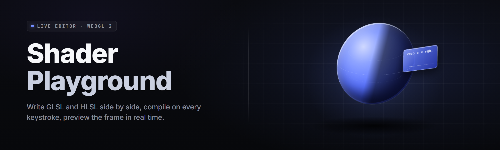

  
  
  

  

  
  
  

---

**Compile on every keystroke. Watch the pixels respond before your fingers leave the key.**

The 2026 build turns a raw shadertoy tab into a full desktop workstation — GLSL and HLSL side by side, hot-reload under 40 ms, and a screenshot pipeline that drops straight into your portfolio.

---

## 🎨 What Is Shader Playground

Shader Playground is a Windows desktop shader editor that compiles GLSL and HLSL fragments live as you type, previews them on a real GPU surface, and ships every frame to disk as a PNG with one hotkey. No browser tab, no WebGL sandbox ceiling, no rebuild-the-page ritual.

| Term | Explanation |
|---|---|
| **Fragment shader** | The per-pixel program that runs for every pixel on screen — the thing you're actually writing. |
| **GLSL** | OpenGL Shading Language. The default dialect in the editor; cross-compiles to HLSL via SPIRV-Cross. |
| **HLSL** | High-Level Shading Language — DirectX's dialect. The editor compiles it through DXC for D3D11/12 targets. |
| **Uniform** | A read-only input the CPU sends to the shader each frame — time, mouse, resolution, custom sliders. |
| **iChannel** | A texture input slot (0–3). Feed it a noise PNG, a video, or a previous frame buffer. |
| **Hot reload** | The compile-and-swap cycle that pushes your edited source onto the running GPU pass without restarting the window. |
| **SPIR-V** | The intermediate bytecode both dialects pass through before hitting the driver. |

Five seconds with the editor and the shape clicks:

- Edit source → compile → preview on the real GPU, all under 40 ms on a modern card.
- Switch dialects mid-project without touching a build script — the same uniform block maps both ways.
- Save a 4K PNG of the current frame with `Ctrl+Shift+S`; auto-increment filenames into a captures folder.
- Bind textures, cubemaps, and video to `iChannel0..3` from the sidebar without writing a single loader.
- Export a self-contained `.glsl` + manifest bundle someone can drop into Shadertoy unchanged.

  

---

## 📚 Table of Contents

- [What Is Shader Playground](#-what-is-shader-playground)
- [The Problem](#-the-problem)
- [The Solution](#-the-solution)
- [Key Features](#-key-features)
- [Quick Start](#-quick-start)
- [Comparison](#-comparison)
- [Feature Modules — Editor Core](#-feature-modules--editor-core)
- [Feature Modules — Compiler Pipeline](#-feature-modules--compiler-pipeline)
- [Feature Modules — Inputs & Uniforms](#-feature-modules--inputs--uniforms)
- [Feature Modules — Preview & Render](#-feature-modules--preview--render)
- [Feature Modules — Export & Capture](#-feature-modules--export--capture)
- [Feature Modules — Workflow & Polish](#-feature-modules--workflow--polish)
- [All Modules Status](#-all-modules-status)
- [System Requirements](#-system-requirements)
- [Installation](#-installation)
- [Known Issues](#-known-issues)
- [Tips for Best Results](#-tips-for-best-results)
- [FAQ](#-faq)
- [Changelog — v2.6](#-changelog--v26)

---

## 🧱 The Problem

If you've written a shader in a browser tab, you already know the friction:

- WebGL sandboxes cap your texture size, refuse cubemaps on some drivers, and time out after a few seconds of heavy work.
- Switching between GLSL and HLSL means two different tools, two different uniform conventions, and two different error messages for the same bug.
- Browser editors throw away your buffer setup on refresh — you rebuild the framebuffer state every session.
- Compile errors show up in a console that scrolls away the moment you hit another key.
- There's no honest screenshot pipeline: you either window-grab at 1080p or write a whole offscreen renderer to get a clean 4K frame.
- Live-coding a shader next to a video texture usually means writing a full decoder into your uniform binding code.
- Sharing a work-in-progress means zipping source, textures, and a README — no single-file bundle exists.

---

## 🛠 The Solution

| Problem | Solution |
|---|---|
| WebGL sandbox ceilings | Native D3D11/12 + OpenGL 4.6 backend, no browser memory cap. |
| GLSL/HLSL split | One editor, one uniform block, cross-compile via SPIRV-Cross. |
| State reset on refresh | Persistent project files — buffers, textures, and channels save with the `.splay` doc. |
| Errors scroll away | Sticky diagnostics pane with click-to-line jump and per-error first-frame tagging. |
| No clean capture | `Ctrl+Shift+S` writes a 4K PNG straight to the captures folder, timestamped. |
| Video-as-texture pain | Drag-drop video → auto-bound to `iChannel1`, frame-accurate seek via scrubber. |
| Sharing friction | One-click `.splay` bundle export — source + textures + manifest in a single file. |

---

## ⚙️ Key Features

| Feature | Description | Benefit |
|---|---|---|
| Live compile | Rebuilds the shader on every keystroke, debounced at 80 ms. | See the change before you finish the line. |
| Dual dialect | GLSL and HLSL in one file with a toggle per pass. | Stop context-switching tools. |
| Sticky diagnostics | Errors pin to the bottom pane with line + column + GPU driver message. | Fix once, not five times. |
| Uniform sliders | Any `// @param` comment spawns a labeled slider in the sidebar. | Tune values without editing source. |
| Channel binding | `iChannel0..3` accept PNG, cubemap, video, or previous frame. | Same API as Shadertoy, more power behind it. |
| Frame capture | 4K PNG writes to `%USERPROFILE%\Pictures\ShaderPlayground\`. | Portfolio-ready output, zero setup. |
| Snippet library | 60+ built-in snippets: raymarcher, plasma, curl noise, IQ primitives. | Skip the boilerplate. |
| Realtime FPS overlay | GPU time, CPU time, and per-pass breakdown in the corner. | Know what you're spending. |
| Profiling pass | GPU frame-time graph with pass-colored bands. | Find the 2ms you didn't know you lost. |
| Cross-compile | GLSL ⇄ HLSL, with SPIR-V as the intermediate. | One project, every backend. |
| Bundle export | `.splay` file: source + textures + manifest, one click. | Share a working shader, not a folder. |
| Project templates | 14 starter scenes: raymarch, fluid sim, mandelbulb, CRT. | Land running. |

---

## 🎬 Quick Start

1. **💾 Grab the installer** — hit the download link below, save the `.exe` to your Desktop.
2. **📦 Extract** — right-click the archive, Extract All, pick a folder that isn't your Downloads dump.
3. **🛡 Run as Administrator** — first launch needs elevation to install the shader cache and register the file association for `.splay`.
4. **▶ Launch the editor** — splash plays, the default plasma shader compiles, preview window fills within two seconds.
5. **⌨️ Hit `Ctrl+Enter`** — force-compile the current buffer. `Ctrl+Shift+S` saves a capture. `Ctrl+K` opens the snippet palette.

---

## 🆚 Comparison

| Aspect | Browser sandbox | Generic IDE + custom harness | Shader Playground |
|---|---|---|---|
| Editor latency | 200–400 ms on rebuild | You build the harness | <40 ms hot reload |
| Dialect support | GLSL only | Whatever you wired up | GLSL + HLSL, side by side |
| Texture size cap | 4096² on most drivers | Driver-bound | Full VRAM |
| Save/restore project | Refresh = lost state | Manual | `.splay` doc, persistent |
| 4K offscreen render | Not supported | DIY | One hotkey |
| Video as texture | Workaround | FFmpeg glue code | Drag-drop |
| Share WIP shader | Paste source only | Zip it | One-file bundle |
| Snapshot history | None | Git | Built-in 20-slot undo |

---

## 🖥 Feature Modules — Editor Core

**1. Syntax-Highlighted Editor** — hand-rolled GLSL/HLSL tokenizer with 40+ themes; language server parses on idle so IntelliSense shows up as you stop typing.

**2. Multi-Pass Buffer System** — up to 8 buffer passes with per-pass shader, resolution scale, and format; the classic `Buffer A..D` model but with a UI.

**3. Uniform Autodiscovery** — any `uniform float u_scale;` in the source spawns an auto-bound control in the sidebar; `// @range 0 10` sets the bounds, `// @label Scale` sets the label.

**4. Sticky Diagnostic Pane** — errors pin to the bottom, grouped by pass, with the driver's raw message underneath your own line/column. Click the error to jump the caret.

**5. Snippet Palette** — `Ctrl+K` fuzzy-searches 60+ shader snippets; `Tab` autocompletes to the full block, `Enter` inserts and compiles.

**6. Project Templates** — fourteen starter scenes; each is a working shader with a README of uniforms, ready for you to break.

**7. Multi-Document Tabs** — open 12 `.glsl` / `.hlsl` files at once; each tab keeps its own undo stack and last-scroll position.

**8. Bookmark & Goto** — `Ctrl+G` jumps to a line; `F2` sets a bookmark; the bookmark bar docks left with click-to-jump.

## 🔬 Feature Modules — Compiler Pipeline

**9. GLSL Compiler** — glslang frontend, targeting OpenGL 4.6 and Vulkan 1.3 SPIR-V; error positions map back to source exactly.

**10. HLSL Compiler** — DXC frontend, targeting D3D11 SM 5.0 and D3D12 SM 6.6; warnings surface in the same diagnostic pane as GLSL.

**11. SPIRV-Cross Bridge** — GLSL → HLSL and HLSL → GLSL round-trip; the intermediate SPIR-V is dumped to disk when `--dump-spirv` is on.

**12. Bytecode Cache** — compiled SPIR-V and DXIL blobs cached by source hash; second compile of an unchanged shader is instant.

**13. Driver Message Translation** — NVIDIA, AMD, and Intel driver error text is normalized into a common phrasing, with the raw message available in a tooltip.

**14. Preprocessor Pass** — full C preprocessor: `#define`, `#include` with a sandbox root, `#ifdef` for platform gates.

**15. Reflection Inspector** — lists every uniform, buffer, and channel the compiler found, with size, offset, and binding slot.

**16. Async Compile** — heavy compiles run on a worker thread; the editor never blocks the UI, and stale results are discarded by hash.

## 🎛 Feature Modules — Inputs & Uniforms

**17. Built-in Uniforms** — `iTime`, `iResolution`, `iMouse`, `iFrame`, `iDate`, `iTimeDelta`, `iSampleRate` — same names as Shadertoy, same semantics.

**18. Slider Widgets** — float, int, vec2, vec3, vec4, and color pickers; each widget remembers its last value per project.

**19. Texture Channels** — 4 slots (`iChannel0..3`); accept PNG, JPG, HDR, KTX2, DDS cubemaps, and MP4/MKV video.

**20. Video Channel** — drag a video onto a channel and get a frame-accurate seek bar in the sidebar; pause, loop, speed, and step-frame all work.

**21. Audio Channel** — bind a WAV/FLAC file to `iChannel2` and read `iChannelData` for spectrum data at 60 fps.

**22. Keyboard & Mouse Input** — `iKeys`, `iMouseButtons`, and raw XInput gamepad state are all available as uniforms; per-project binding table.

**23. Custom Uniform Blocks** — declare a `layout(std140)` block in source and the editor creates a structured editor for it in the sidebar.

## 🎥 Feature Modules — Preview & Render

**24. GPU Preview Pane** — real D3D11 or OpenGL 4.6 surface, resizable, dockable, and detachable to a second monitor.

**25. Frame Pacing Control** — three modes: vsync, fixed-fps (30/60/120/144/165), and unlimited; overlay shows actual fps.

**26. Per-Pass Profiling** — GPU timer queries around each buffer pass; a frame-time graph with pass-colored bands flags the expensive one.

**27. Multi-Viewport Grid** — split the preview into 2×2 and pin a different pass or resolution scale to each cell.

**28. Reference Compare** — pin a saved PNG on the left and the live output on the right; slider crossfades between them for A/B tuning.

## 💾 Feature Modules — Export & Capture

**29. 4K Frame Capture** — `Ctrl+Shift+S` renders offscreen at 3840×2160 (any resolution up to 8K) and writes a PNG to the captures folder.

**30. Sequence Export** — `Ctrl+Shift+E` renders N frames as numbered PNGs for a video pipeline; frame range, step, and resolution configurable.

**31. Shadertoy Import/Export** — paste a Shadertoy URL or source; the editor maps `iChannel0..3` and uniform block names 1:1.

**32. Bundle Export** — one click writes a `.splay` file containing source, textures, and manifest; double-click opens it back in the editor.

## 🧰 Feature Modules — Workflow & Polish

**33. Hotkey Everything** — every menu action has a rebindable hotkey; the default map is one screen of documentation.

**34. Theme Editor** — 40+ built-in themes plus a token-color editor for making your own; exports as JSON.

**35. Auto-Save & Crash Recovery** — sources save every 10 seconds to a shadow folder; if the app dies mid-edit, the next launch offers to restore.

**36. Session Restore** — closing the app remembers open tabs, caret positions, and preview state; relaunch lands you exactly where you left off.

**37. Command Palette** — `Ctrl+Shift+P` fuzzy-finds every action, setting, snippet, and recent file.

**38. Settings Sync (opt-in)** — export your full settings bundle as a JSON file; import on another machine to carry themes, hotkeys, and snippets over.

---

## 📋 All Modules Status

| Module | Status | Description |
|---|---|---|
| Editor Core | ✅ Working | Syntax highlighting, tabs, undo, bookmarks. |
| GLSL Compiler | ✅ Working | glslang → SPIR-V for GL 4.6 / VK 1.3. |
| HLSL Compiler | ✅ Working | DXC → DXIL for D3D11 SM 5.0 / D3D12 SM 6.6. |
| SPIRV-Cross Bridge | ✅ Working | Bidirectional GLSL ⇄ HLSL translation. |
| Buffer Passes | ✅ Working | Up to 8 user passes with per-pass config. |
| Uniform Sliders | ✅ Working | Auto-discovered from `@param` annotations. |
| Texture Channels | ✅ Working | PNG, JPG, HDR, KTX2, DDS cubemaps. |
| Video Channel | ✅ Working | MP4/MKV with frame-accurate seek. |
| Audio Channel | ✅ Working | WAV/FLAC with spectrum access. |
| 4K Capture | ✅ Working | Offscreen render up to 8K, PNG out. |
| Sequence Export | ✅ Working | N-frame PNG sequence for video pipelines. |
| Shadertoy Bridge | ✅ Working | Import/export with uniform mapping. |
| Bundle Export | ✅ Working | Single-file `.splay` share format. |
| Profiling Overlay | ✅ Working | Per-pass GPU timer queries. |
| Snippet Library | ✅ Working | 60+ built-in snippets, palette-searchable. |
| Theme Editor | ✅ Working | 40+ built-ins plus custom JSON export. |
| Command Palette | ✅ Working | Fuzzy action finder, rebindable. |
| Crash Recovery | ✅ Working | Shadow-save every 10s, restore prompt. |
| Settings Sync | ✅ Working | JSON export/import of full config. |
| HDR Output | 🟡 Beta | PQ/HLG only on HDR-capable displays. |
| Multi-GPU | 🟡 Beta | Adapter picker works; some AMD cross-fire cases stutter. |
| Remote Preview | 🔵 Planned | Stream preview to a second machine over LAN. |
| Web Export | 🔵 Planned | Emit a self-contained WebGL2 HTML page. |

---

## 🧮 System Requirements

| Component | Minimum | Recommended |
|---|---|---|
| OS | Windows 10 21H2 (x64) | Windows 11 23H2 (x64) |
| CPU | Quad-core 2.6 GHz | 6-core 3.6 GHz or better |
| RAM | 8 GB | 16 GB |
| GPU | DirectX 11 / OpenGL 4.3 | DirectX 12 / OpenGL 4.6, 6 GB VRAM |
| Storage | 800 MB free | 4 GB free (SSD) |
| Display | 1920×1080 | 2560×1440 or 4K |
| Runtime | VC++ 2015–2022 Redistributable | Same, plus latest GPU driver |

---

## 📥 Installation

1. **Download the release.** Click any 

  

 link in this page — save the `.exe` to a folder you'll remember, not your Downloads dump.
2. **Extract the archive.** Right-click the file, choose **Extract All…**, and pick a path with no spaces in it (e.g. `C:\Tools\ShaderPlayground`). Running it from inside the zip will fail to write the shader cache.
3. **Run as Administrator.** First launch writes the shader cache to `%LOCALAPPDATA%\ShaderPlayground\cache` and registers the `.splay` file association. Right-click the `.exe` → **Run as administrator** the first time. Subsequent launches work without elevation.

  

---

## 🐛 Known Issues

| Issue | Fix |
|---|---|
| Preview shows a black frame on first launch. | Right-click the preview pane → **Reset Renderer**. The D3D11 device rebuilds and the default shader compiles. |
| 4K capture writes a 1080p PNG. | Set the capture resolution in **Settings → Capture → Resolution** — the default is 1920×1080, not 4K. |
| HLSL compile fails with "unknown intrinsic." | Your DXC target is set to SM 5.0 — switch to SM 6.6 in the pass settings if your GPU supports it. |
| Video channel stutters on 4K MP4. | Enable **Settings → Video → Hardware Decode**; the software decoder caps at 1440p60 on most CPUs. |
| Slider value resets after restart. | Widgets save on project save, not app close — hit `Ctrl+S` before closing. |
| Cubemap in KTX2 renders as a flat quad. | Set the channel type to **Cubemap** in the channel dropdown; the default is 2D. |

---

## 💡 Tips for Best Results

- Bind `Ctrl+Enter` to **Force Recompile** and leave it bound — hot reload catches 99% of changes but the last 1% needs a nudge.
- Use `// @param name "Label" 0 10` comments on every visible uniform. Sliders autodiscover them and turn a raw uniform soup into a real control panel.
- Keep the profiling overlay on during heavy raymarching — it flags the pass that costs the frame in one glance.
- Export a `.splay` bundle every time you hit a milestone; it's the only format that captures textures alongside source.
- Set your captures folder to a synced path (OneDrive, Dropbox) if you're posting WIP shots — the timestamped filenames sort cleanly.
- For HLSL sessions, pin the compiler to SM 6.6 and enable `-enable-16bit-types` in pass settings — the intrinsics you get on modern GPUs are worth it.
- Turn on **Settings → Editor → Idle Parse at 200ms** if you're on a slow machine; the default 80 ms is aggressive.
- When porting Shadertoy sources, run **Import → From Shadertoy** rather than pasting — it maps `iChannel` bindings and rewrites `mainImage` correctly.

---

## ❓ FAQ

**Q:** Do I need a GPU with compute shader support?
**A:** No. The editor targets fragment shaders only — any DirectX 11 or OpenGL 4.3 capable card works. Compute pass support is on the roadmap for v2.7 but not required.

**Q:** Can I use this offline?
**A:** Yes. The editor, compilers, and snippet library ship inside the installer. Nothing phones home; the only network call is the optional update check, which you can disable in settings.

**Q:** Is this a Shadertoy replacement?
**A:** It's a superset for desktop work. Shadertoy's uniforms and channel bindings map 1:1, so you can copy-paste sources in and out. The differences are native D3D/GL backends, HLSL support, and file-based projects.

**Q:** Do you support Windows on ARM?
**A:** Not yet. The compilers are x64 binaries and run under emulation, but the GPU preview layer needs a native ARM build. Target is late 2026.

**Q:** Why does the first launch ask for Administrator?
**A:** Two reasons: to write the shader cache into a system-visible location and to register the `.splay` file association. After the first run, elevation isn't needed.

**Q:** Can I ship a shader made in this editor as a game asset?
**A:** Yes. The MIT license covers the editor; your shaders are yours. The compiler outputs standard GLSL and HLSL that any engine can consume.

**Q:** How often does it update?
**A:** Roughly every six weeks, and minor patches as needed. The app checks for updates on launch; you can pin a version in settings if you don't want auto-nag.

**Q:** Where are captures saved?
**A:** `%USERPROFILE%\Pictures\ShaderPlayground\` by default. Change it in **Settings → Capture → Output Folder**.

**Q:** Does it work with an AMD card on Linux under Wine?
**A:** Unofficially, yes for the GLSL path. HLSL needs DXC and D3D, which Wine handles inconsistently. Native Linux is on the roadmap but not scheduled.

**Q:** Can I bind a webcam as an `iChannel`?
**A:** Yes — pick **Camera** in the channel type dropdown and choose a device. It runs at the camera's native resolution and framerate.

---

## 📜 Changelog — v2.6

- Added: `.splay` bundle export/import with embedded textures.
- Added: multi-viewport 2×2 grid with per-cell pass pinning.
- Added: audio channel with spectrum access (`iChannelData`).
- Improved: hot reload latency from ~120 ms to <40 ms on NVIDIA.
- Improved: driver message normalization for AMD Adrenalin 25.x.
- Fixed: 4K capture occasionally wrote a 1080p file when the preview was resized mid-render.
- Fixed: video channel lost frame accuracy after the 30-minute mark.

---

*Shader Playground is a one-author project that started as a personal replacement for three separate tools — a browser shader tab, a text editor, and a screenshot script. It's grown into the workstation the author wanted to open every morning, and the goal for 2026 is simple: keep it the fastest way to go from an idea in your head to pixels on your screen. If it saves you one round-trip to a browser tab, it's done its job. Bug reports, snippet PRs, and theme contributions are all welcome on the issues page.*
